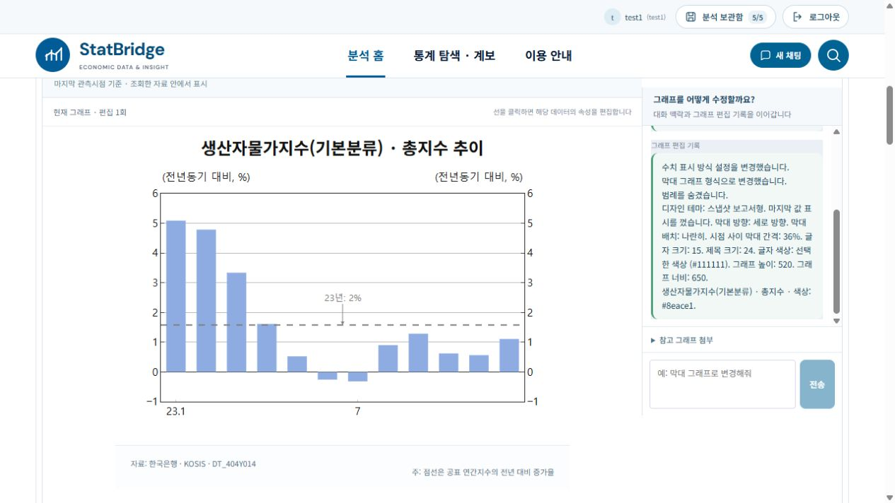
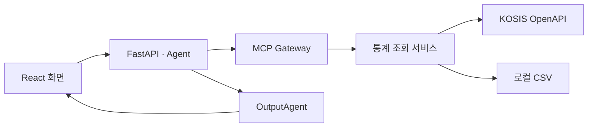

# StatBridge

**한국은행 경제통계를 자연어로 찾아, 출처가 남는 그래프와 표로 만드는 로컬 분석 도구입니다.**

통계표 이름이나 계열 코드를 몰라도 필요한 지표를 말로 요청할 수 있습니다. StatBridge는 한국은행 통계표 349개의 메타데이터에서 후보를 찾고, 기준에 따라 결과가 달라지는 경우에는 확인 질문을 합니다. 선택한 원자료를 조회한 뒤 계산 근거와 출처를 함께 보여줍니다.

[실행 안내](docs/getting-started.md) · [기술 문서](docs/README.md) · [평가 자료](eval/README.md)

*한국은행 생산자물가지수를 조회한 뒤 막대 형태와 기준선을 편집한 화면입니다. 그래프 아래에서 자료 출처와 통계표 ID를 확인할 수 있습니다.*

## 사용 흐름

> 2023년 1월부터 12월까지 생산자물가지수(기본분류) 총지수를 월별 선 그래프로 보여줘.

1. **찾기** — 요청에서 지표·기간·비교 기준을 파악하고, 등록된 통계표와 계열을 선택합니다.
2. **확인하고 계산하기** — 필요한 기준을 확인한 뒤 KOSIS 또는 설정된 로컬 CSV에서 원자료를 조회합니다. 파생지표는 단위와 주기 등을 검증한 계산식으로 처리합니다. 필요한 자료는 파일로 보완할 수 있습니다.
3. **편집하고 내보내기** — 조회 결과에서 전년동기 막대그래프로 바꿀 수 있습니다. 그래프의 축·범례·주석과 표의 서식을 편집합니다. 그래프는 PNG·SVG·PDF, 표는 XLSX·CSV·PNG·PDF로 내보낼 수 있습니다.

## 설계

모델은 질문 해석과 파생 계산 계획을 돕습니다. 표·계열 ID는 등록된 메타데이터에서 선택하고, 계산은 Python 서버가 검증된 원자료로 실행합니다. 화면의 Agent는 MCP Gateway를 같은 프로세스에서 호출하며, 독립 MCP 서버도 같은 조회 서비스를 공유합니다. [질의에서 통계표 조회까지](docs/architecture/STATBRIDGE_UI_TO_TABLE_RETRIEVAL_FLOW_DETAILED.md)

| 위치 | 역할 |
| --- | --- |
| [`src/agent/frontend/`](src/agent/frontend/) | React·TypeScript 화면과 그래프·표 편집 |
| [`src/agent/`](src/agent/) | FastAPI, 질의 해석, 파생 계산, 출력 생성 |
| [`src/backend/`](src/backend/) | 통계표 검색, 메타데이터, 원자료 조회, MCP 서버 |
| [`data/processed/`](data/processed/) | 공개 카탈로그 메타데이터 |
| [`tests/`](tests/) · [`eval/`](eval/) | 자동 테스트와 공개 개발 평가 |
| [`docs/`](docs/README.md) | 실행 안내, 아키텍처, 기능별 기술 기록 |

## 실행

Windows에서 저장소를 내려받아 압축을 푼 뒤 [`START_STATBRIDGE.cmd`](START_STATBRIDGE.cmd)를 실행합니다. 기본 접속 주소는 `http://127.0.0.1:5173`입니다. API 키 없이도 화면과 카탈로그를 확인할 수 있습니다. KOSIS 실조회, 모델 기능, 로컬 CSV 조회의 준비 사항은 [실행 안내](docs/getting-started.md)에서 확인하세요.

## 평가

| 평가 | 확인 범위 |
| --- | --- |
| [표 탐색 v4.1](eval/table-discovery/v4.1/README.md) | 공개 개발 50건과 테스트 70건으로 질의 해석·표 선택을 점검합니다. 공개 보류 30건은 질문만 제공합니다. |
| [최소 E2E v2.2](eval/min-e2e/README.md) | 원자료 조회, 조건 확인, 파생 계산 등의 전체 흐름을 검증하는 공개 개발 평가 120문항입니다. 실행 환경과 버전별 결과는 별도 기록에 정리되어 있습니다. |
| [3인 정성평가](docs/evaluation/2026-11-03-qualitative-10-3p.md) | 최소 E2E v1.4에서 선정한 10문항의 검토 기준과 종합 보고서입니다. |

[평가 계열별 범위와 재현 조건](eval/README.md) · [기여 및 검증 규칙](CONTRIBUTING.md)
