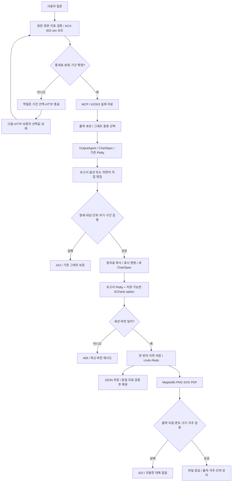

# 고급 통계 그래프 아키텍처

2026-10-12, ai-assisted. 적용 체크아웃은 StatBridge-local1이다. 기존 미커밋 편집·이모티콘 패치는 보존한다.

## 현재 코드와 재사용 경로

| 영역 | 실제 경로 | 역할 |
|---|---|---|
| 질의 | `agent_runtime.py`, `stat_language_resolver.py`, `request_match_guard.py` | 원문·정본 지표 선택, HCX-003 분류 보조, Jev 선택적 계열 수 판단, 최종 조회 검증 |
| 데이터 | `src/backend/statbridge_mcp/statistics_service.py` | MCP/KOSIS 또는 공급된 로컬 자료 조회 |
| 실행 | `langgraph_workflow.py` | 질의 해석·확인 대기·조회·출력 선택·출력 노드. 확인 대기는 HTTP 종료 후 새 요청으로 재진입 |
| 초기 출력 | `bridge_api.py` `/api/output`, `OutputAgent.prepare` | 저장된 조회 세션으로 ChartSpec 생성 |
| 기존 렌더러 | `plotly_renderer.py`, `research_plotly_styles.py`, App.tsx의 PlotlyRenderer | Plotly Python 6 / Plotly.js 3.7. 기존 그래프·그림판·저장 이미지 유지 |
| 편집 | `chart_edit_agent.py`, `OutputAgent.apply_edits`, `/api/output/edit` | HCX-007 명령 해석, 전체 요청 accounting, 스키마·대상 검증, 원자적 적용, 버전 검사, Undo/Redo |
| 보고서 확장 | `advanced_chart_spec.py`, `advanced_chart_render.py`, `report_export.py` | 같은 관측값을 쓰는 ReportOptions·ChartDocument·세 렌더러·저장 복원·출력 |
| UI | `ReportPanel.tsx`, `ReportPreview.tsx` | 수정이 사이드바의 직접 설정·파일 복원·ECharts 미리보기 |

기존 Plotly 명세는 범례·축·주석·강조·복합축·패널·이모티콘을 이미 지원했다. 부족했던 전문 유형, 제공된 신뢰구간, 출처·각주, 지속 가능한 명세 파일, 벡터 인쇄 출력을 별도 레이어로 확장했다. HCX-003/Jev/KOSIS/MCP의 역할과 호출은 바꾸지 않았다. 표시 변환의 전년 대비 주기 처리 오류는 별도로 수정했다.

## 기술 선택

| 기술 | 적용 | 비용·제약 |
|---|---|---|
| Plotly | 기존 주 렌더러 유지; 보고서 도형·메모·그림판 호환 | 기존 대형 번들 유지. 전면 교체로 인한 편집 회귀를 피함 |
| ECharts 6.1 | 필요한 차트·컴포넌트와 SVG 렌더러만 별도 지연 로딩 | 미리보기 청크 640.92kB, gzip 215.39kB. 같은 자료를 변환하되 저장 이미지/위치 도형/구간별 스타일/바이올린은 지원하지 않는 이유를 표시 |
| Matplotlib 3.11 | 서버 Agg PNG, 벡터 SVG/PDF | 한국어 시스템 폰트 필요. 공유 rc/font 상태를 잠금. 임의 코드 실행 없음 |
| D3 | 도입하지 않음 | 필수 유형에 추가 라이브러리가 필요하지 않음. 네트워크 등 전용 데이터 어댑터 전에는 도입하지 않음 |

라이선스 근거는 설치본 Plotly의 MIT 메타데이터, ECharts 패키지의 Apache-2.0, Matplotlib 설치본 LICENSE를 확인한다. Matplotlib은 자체/PSF 계열 라이선스와 포함 자산 조건을 따른다. 시스템 폰트를 저장소에 복사하거나 배포하지 않는다. Vite 8.3.0과 React 플러그인 6.1.1은 기존 검증 버전으로 고정했다.

공식 기술 문서: [ECharts Canvas/SVG](https://echarts.apache.org/handbook/en/best-practices/canvas-vs-svg/), [Matplotlib 출력 백엔드](https://matplotlib.org/stable/users/explain/figure/backends.html), [PDF/SVG 폰트](https://matplotlib.org/stable/users/explain/text/fonts.html). SVG 윤곽선은 글꼴 없는 컴퓨터에서 모양을 보존하고, 텍스트 모드는 동일 폰트가 필요하다. PDF는 사용 글리프를 서브셋으로 포함한다.

## 실제 흐름

API 코드에서 세션 스냅샷을 복사하고 편집 버전을 검사한다. 파일 경로·URL·임의 Python/JS를 받지 않는다. ECharts의 팬/워터폴 custom renderer는 고정된 애플리케이션 함수이며 모델 코드를 컴파일하지 않는다.
