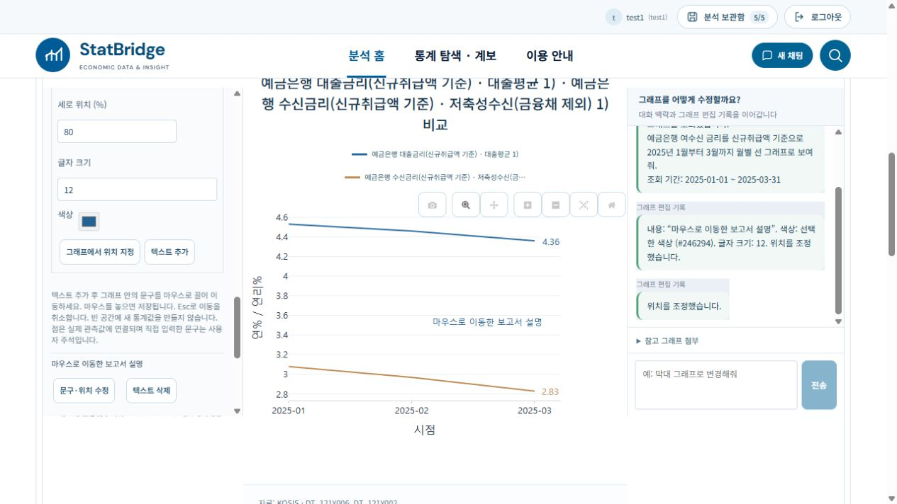

# 그래프 텍스트 마우스 이동 (2026-10-20)

ai-assisted. 왼쪽 속성의 ‘관측점 · 직접 텍스트’에서 문구를 입력하고 ‘텍스트 추가’를 누른 뒤 그래프 안의 문구를 직접 끌어 이동한다. 마우스를 놓으면 기존 검증된 update_note 편집 경로로 위치를 저장한다. 속성 패널을 닫아도 동작한다.

- 이동 중에는 SVG 텍스트만 미리보기로 옮긴다. 마우스 이동마다 서버나 GPT를 호출하지 않으며, 놓았을 때 한 번만 편집 명령을 보낸다.
- 짧은 클릭, Esc, pointercancel, 창 blur, 컴포넌트 해제는 부분 이동을 저장하지 않는다. 실패하면 기존 위치를 유지하고 오류를 표시한다.
- 사용자 주석 ID에 연결된 문구만 이동한다. 자동 최근 관측값·제목·출처 등은 사용자 텍스트로 오인하지 않는다.
- 자유 텍스트는 그래프 그리기 영역의 상대 좌표로 저장하며 영역 밖으로 이동하지 않는다. 관측점 라벨은 실제 시점·값 연결을 유지하고 검증된 픽셀 이동 범위 안에서 위치만 바꾼다.
- Plotly의 자동 정렬이 영역 위치에 따라 바뀌어 놓은 뒤 텍스트가 튀지 않도록 내부 주석은 중심 정렬을 명시했다. 하단 출처 배치는 유지한다.
- 기존 편집 이력과 명시적 분석 저장·내보내기 경로를 이용한다. 계정 DB·저장 분석·원자료·.env는 복사하거나 초기화하지 않았다.

## 검증

local1과 StatBridge1에 같은 소스·테스트를 반영하고 두 백엔드를 재시작했다. 두 UI에서 실제 금리 그래프에 새 텍스트를 추가하고 마우스로 끌어 이동한 뒤 서버 반영을 확인했다. local1에서는 약 90px 오른쪽·100px 아래로 이동해 실제 DOM의 이동량이 89px·100px임을 확인했다. SVG 중심 정렬 후 마우스를 놓은 위치에 유지되었다. 실제 PNG를 내려받아 이동한 텍스트 위치가 포함됨을 시각 확인했다.

각 폴더 Node 218 PASS / 0 FAIL / 0 SKIPPED. 신규 14건은 좌표 방향·영역 제한·관측점 연결 보존·데이터 불변·놓을 때 1회 저장·짧은 클릭 무호출·취소/해제·자동 라벨 제외·실패 복원을 검증한다. 두 폴더 TypeScript/Vite 빌드 PASS. local1 관련 Python 54 PASS (관측점·텍스트·기존 차트 편집). 전체 Python 2,251건은 직전 PR 검증이며 이 후속 변경에서 다시 실행했다고 합산하지 않는다. Esc와 실패 복원은 자동 테스트로 확인했으며 실제 사용자 환경의 모든 입력 장치·브라우저 조합을 전수 검사하지 않았다. 이번 다운로드 검증은 PNG에 한정한다.

