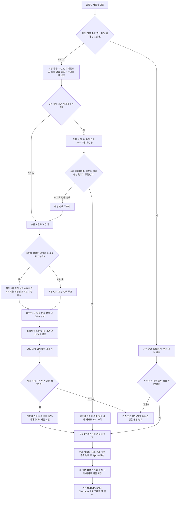

# 파생지표 계획 재사용·메타데이터 사전 제공 (ai-assisted)

## 적용 범위

local1과 StatBridge1에 같은 코드와 검사를 반영하고 운영 백엔드를 재시작했다. 지표 레시피나 수치를 미리 계산하지 않는다. 최초 계산식은 GPT-5.4가 실제 후보 메타데이터를 보고 설계하며 별도 경제학적 의미 검토를 유지한다. 동일 조건의 API 전용 승인 계획만 요청 후 잠시 메모리에서 재사용한다.

## 상세 실행 흐름

위 다이어그램의 파일·수정 경로는 기존 자체 검증·계산을 유지한다. 캐시 적용 대상으로 편입하지 않았다. 실패 결과, 자료 부족, 의미 검토 거부, 아직 계산하지 말라는 요청은 승인 계획으로 저장되지 않는다. 성공 결과만 저장되며 매번 새 원자료를 조회한다. 파일 SHA·첨부 상태가 다른 요청을 API 계획과 섞지 않는다.

## 안전 조건과 수명

- `VerifiedPlanCache`: 프로세스 메모리에 최대 64항목, 생성 후 300초. 디스크·브라우저 영구 캐시 없음. 재시작 시 비워진다.
- 서버의 인증 ContextVar에서 계정을 얻는다. 요청 JSON이 소유자를 지정할 수 없다. 비인증·직접 호출에는 재사용하지 않는다.
- 질문은 원문 그대로 키에 사용한다. 기간·추가 인자·모델·카탈로그 버전이 다르면 재사용하지 않는다. 서로 다른 자연어를 임의로 같은 의도라고 병합하지 않는다.
- 계획기·스키마·검증기·지원 정책·런타임·캐시 코드의 지문도 키에 포함된다. 서버 배포 후 재시작한다.
- 의미 검토 `approved=true`와 런타임 검증을 통과한 승인 349개 표 입력만 저장한다.
- 적중 시 현재 source ID·단위·주기·DAG·자원 검증 및 원자료 메타데이터 전체 지문을 재확인한다. 다르면 폐기하고 의미 검토를 포함한 전체 계획 흐름으로 돌아간다.
- 의미 검토를 삭제한 것이 아니다. 정확히 같은 계약에 대한 승인 결과만 재사용하며 새 계약은 다시 검토한다. 기록에는 `plan_cache_hit`, `semantic_review_reused`, 메타데이터·정책·승인 계획·의미 검토의 해시를 남긴다.
- 실제 메타데이터의 기존 유효기간은 `LiveDerivedCatalog`의 1시간 캐시 정책을 따른다. 적중 때마다 메타데이터 네트워크를 강제 새로 호출한다고 주장하지 않는다. 관측값 네트워크는 매번 다시 호출한다.
- 반환값과 저장값은 깊은 복사로 격리한다. 호출자가 계획을 수정해 이후 계획을 오염시키지 않는다.

## 최초 요청 단축

사전 제공은 `LiveDerivedCatalog`에서만 활성화한다. 질문에 표 이름이 명시된 후보 최대 2개에 기존 `bounded_metadata`를 적용한다. 항목 최대 48개·분류별 값 최대 32개를 제공하고, 실제 제공한 ID만 inspected 집합에 넣는다. GPT가 최종 표를 확정하며 모호한 표를 상위 1개로 강제 선택하지 않는다. 사전 제공에 없는 분류는 기존 metadata 검색 경로를 이용한다.

Cloud에는 `planner.action`과 `planner.semantic_review`를 별도 span으로 기록하여 계획 생성과 경제학적 검토를 구분한다. 재사용은 `planner.plan`의 처리 정보에서 확인할 수 있다. UI도 해당 단계의 한국어 이름을 표시한다.

## 실제 질문·Langfuse 검증

질문은 이전 보고서와 동일하다.

> 2023년 1월부터 12월까지 생산자물가지수(기본분류) 총지수의 전년동월 대비 변화율을 계산해서 월별 선 그래프로 보여줘.

| 실행 | 분석 | 출력 | 서버 시간 합계 | GPT 호출 |
| --- | ---: | ---: | ---: | ---: |
| 패치 전 local1 최초 | 14.825초 | 0.230초 | 15.055초 | 3 |
| 패치 전 local1 반복 | 11.684초 | 0.388초 | 12.071초 | 3 |
| 패치 후 local1 최초 | 14.672초 | 0.411초 | 15.083초 | 2 |
| 패치 후 local1 반복 | 1.442초 | 0.348초 | 1.790초 | 0 |
| 패치 후 StatBridge1 최초 | 12.266초 | 0.264초 | 12.530초 | 2 |
| 패치 후 StatBridge1 반복 | 1.304초 | 0.345초 | 1.649초 | 0 |

local1의 반복 서버 시간은 직전 패치 전 반복 실행 대비 약 85.2% 감소했다. 최초 호출 수는 3→2로 줄었지만 local1 최초 전체 시간은 개선됐다고 볼 수 없다. 모델 응답시간 변동과 동시 회귀 실행의 영향을 통제한 대규모 벤치마크는 아니다. 서버 시간 합계에 브라우저 렌더링/통신 시간은 포함하지 않는다. 각 앱 2회 실행으로 p50/p95를 주장하지 않는다.

두 최초 실행 모두 별도 의미 검토 span이 수신됐다(local1 4.443초, StatBridge1 3.373초). 두 반복 실행은 `plan_cache_hit=true`, 기존 의미 승인 재사용, GPT 0회, 실제 KOSIS 관측값 재조회 1회를 확인했다. 8개 요청 trace의 observation 416개를 ID별로 Cloud와 대조해 전부 수신됐다. 실제 모델 호출은 두 앱 합계 4회다.

각 앱의 최초/반복 계산 12개씩 총 48개를 실제 KOSIS 관측값으로 독립 Decimal 검산했고 허용오차 1e-10 이내였다. 반복의 계획 해시는 최초와 동일하며 새로운 계산 ID와 근거가 생성됐다. 기존 `.env`·계정·저장 분석의 내용 해시는 유지됐다.

실제 trace:

- [local1 최초](https://jp.cloud.langfuse.com/project/cmvg1py7e000had0jhg7btzan/traces/94b178484b2f402f852830c9c2d62f92)
- [local1 반복](https://jp.cloud.langfuse.com/project/cmvg1py7e000had0jhg7btzan/traces/2172e803f0bd4d459dcfc46de1c2d1b4)
- [StatBridge1 최초](https://jp.cloud.langfuse.com/project/cmvg1py7e000had0jhg7btzan/traces/cdab2b19c6bf4ef2b2295fe6deb15227)
- [StatBridge1 반복](https://jp.cloud.langfuse.com/project/cmvg1py7e000had0jhg7btzan/traces/a448eb99a1374d42a6c367f64c91389d)

## 코드·파일 정리

실행 코드·공개 테스트·도구·스크립트 Python 파일 257개에 대해 직접 import 관계를 조사했다. 내부 런타임 모듈에서 직접 참조가 없는 후보는 패키지 진입용 `__init__.py`뿐이어서 유지했다. CLI·문자열 기반 동적 로딩 때문에 참조 검색 하나만으로 전체 미사용을 증명할 수는 없다. 재현 가능한 평가 도구나 호환 패키지를 임의 삭제하지 않았다.

현재 실행·검사·문서에서 참조하지 않는 과거 일회성 복사 스크립트 3종을 두 폴더에서 제거했다.

- `tools/sync_derived_files.py`
- `tools/sync_derived_followup.py`
- `tools/sync_derived_v6.py`

이 스크립트들은 특정 과거 평가 버전의 파일 목록과 경로를 복사하는 용도였다. 현재 런타임에서 호출되지 않으며 오래된 동기화 목록을 다시 실행할 필요가 없다. 삭제 경로·해시는 `sync-cleanup.json`에 남겼다. Markdown 문서·평가 결과·과거 patch diff·감사 기록·원자료·계정·보관 분석은 삭제하지 않았다. 새 패치를 위해 만든 일회성 영구 도구는 없다. `derived_plan_cache.py`는 현재 런타임이 사용하는 모듈이며 신규 테스트도 이후 회귀에 필요하므로 유지한다.

## 검증 기록 위치

각 프로젝트 `.venv/cache/langfuse-20261020/optimization/`에 실제 trace·수치 검산·보존 확인·UI 화면·테스트 결과를 보관했다. `live-results.json`과 `live-traces.json`은 각 앱에서 실제 실행한 결과이며 서로 덮어쓰지 않는다. local1의 `sync-cleanup.json`, `dependency-audit.json`은 동기화/삭제/참조 조사 기록이다.

오프라인 회귀는 모델 키와 Cloud 전송을 끄고 임시 계정 DB로 실행한다. 샌드박스에서 HTTP 테스트가 멈춘 초기 실행은 중단 상태로 별도 보관했으며 PASS 수에 포함하지 않는다. 프런트엔드는 npm test 스크립트가 없어 해당 시도는 실패 기록으로 남기고, 실제 저장소 테스트 명령 `node --test test-*.mjs`로 두 폴더 각각 192 PASS를 확인했다. TypeScript·Vite 빌드도 두 폴더 PASS다. 기존 큰 번들 경고는 남아 있다.

### 추가 검증 및 정리 결과

- StatBridge1의 캐시 경계 신규 15개 + 실제 메타데이터 어댑터 모의 검사 4개: 19 PASS, 0 FAIL.
- 두 폴더 각각 Node 프런트엔드 192 PASS, 0 FAIL, 0 SKIP 및 TypeScript/Vite 빌드 PASS.
- 두 폴더 각각 격리된 HTTP 회귀 13 PASS, 0 FAIL, 0 SKIP. 고정 첨부 관측값을 사용한 오류·권한·XLSX 보존 검사이며 실제 KOSIS 검증으로 세지 않는다.
- 실제 Cloud 메타데이터에서도 두 반복 trace의 plan_cache_hit=true, semantic_review_reused=true를 확인했다.
- local1 최초 GPT 입력/출력은 8,127/649토큰(합계 8,776)으로 이전 최초 13,815토큰 대비 약 36.5% 감소했다. 캐시 토큰별 요율이 다르므로 이를 요금 감소율로 보고하지 않는다. StatBridge1 최초는 합계 8,700토큰이었다. 반복 실행의 신규 GPT 토큰은 0이다.
- 삭제한 스크립트의 남은 컴파일 파일 1개도 제거했다. 예전 UI 평가용 서버 8005/8006 및 5175/5176은 종료했고 기록과 재사용 평가 도구는 유지했다. 운영 API 8000/8001과 UI 5173/5174는 계속 실행한다.

### 최종 전체 회귀

local1 공개 회귀 98개 파일: **2,059 PASS + 355 subtests PASS / 0 FAIL / 0 SKIP**, 539.99초. 실행 중 검사 대상 소스 불변 확인 PASS. 모델 키와 Langfuse 전송 비활성, 별도 테스트 계정 DB 사용. StatBridge1에서는 위의 대상 회귀 19건·HTTP 13건·프런트엔드 192건·빌드를 별도 실행했으며 전체 2,059건을 다시 실행한 것으로 보고하지 않는다.

최종 검증 시 두 운영 API 및 UI 모두 HTTP 200, 두 폴더의 변경 공유 파일 8개 내용 일치, 각 .env·계정·저장 분석 해시 동일. local1은 기존 5계정/9개 분석, StatBridge1은 4계정/5개 분석을 유지한다. 초기 중단된 샌드박스 회귀는 최종 PASS/미실행 통계에 섞지 않는다.
