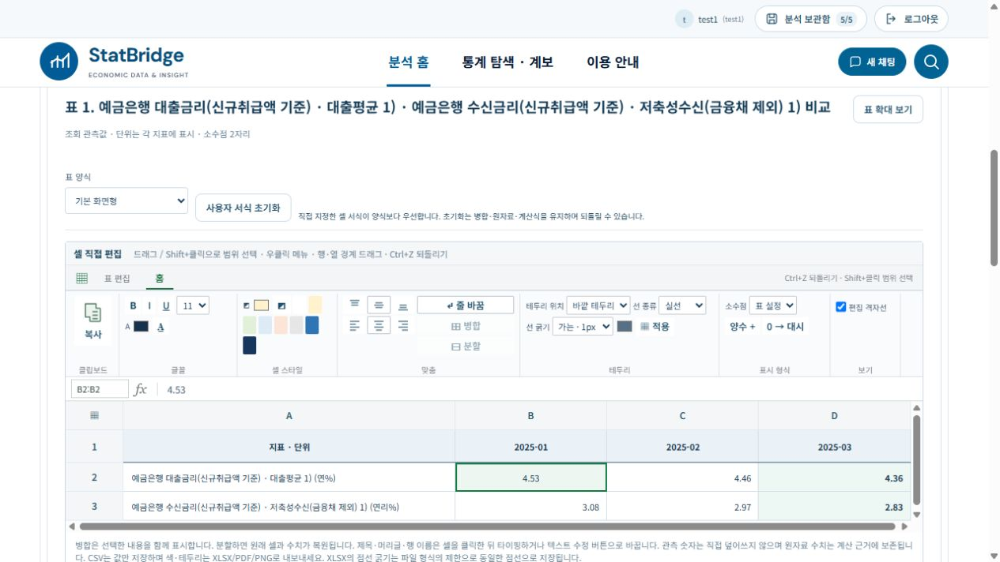
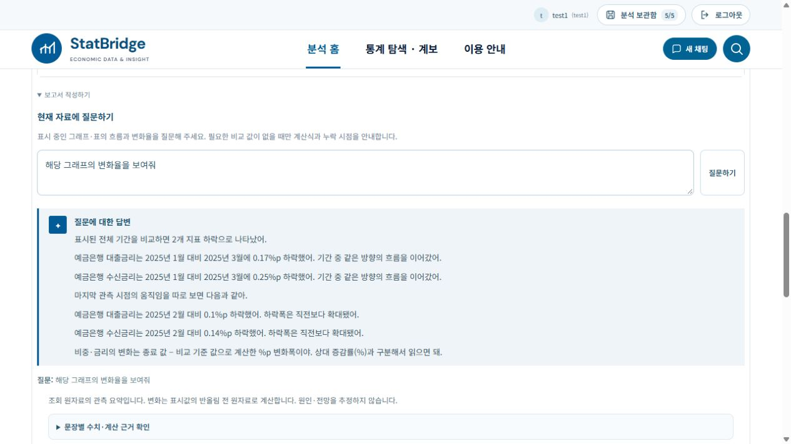

# 2026-10-20 Excel 샘플 기반 리본 UI와 현재 자료 설명 개선

ai-assisted 변경. local1과 StatBridge1의 소스·테스트·기록을 동일하게 반영했다. 계정, 저장 분석, .env와 원자료는 복사하거나 초기화하지 않았다.

## UI 변경

사용자가 제공한 Excel 홈 리본 샘플을 기준으로 초록색 전체 띠와 큰 테두리 버튼을 제거했다. 밝은 회색 탭, 녹색 홈 밑줄, 작은 아이콘과 사각 드롭다운, 얇은 그룹 구분선으로 변경했다. 복사·글꼴·셀 스타일·맞춤·테두리·표시 형식·보기 그룹은 유지한다. 가로·세로 맞춤은 실제 편집 명령을 실행하는 6개 아이콘으로 바꿨다. 비활성 상태와 적용 상태, title/aria-label로 기능을 구분한다. 선택 주소, fx 표시줄과 녹색 셀 선택 표시도 유지한다. 리본 그룹 높이를 106px로 줄였으며 작은 화면에서는 가로 스크롤한다.

현재 지원하지 않는 Excel 메뉴나 수식 기능을 장식용 버튼으로 추가하지 않았다. 데이터 값 직접 덮어쓰기 제한, 기존 셀 병합·분할·색상·테두리·되돌리기 등 검증 경로는 유지한다.

## 답변 형식 확인

[통화신용정책보고서 2025년 3월](https://www.bok.or.kr/portal/bbs/B0000156/view.do?depth=200754&menuNo=200754&nttId=10090271&oldMenuNo=201150&programType=newsData&relate=Y)과 [2025년 9월 보고서](https://www.bok.or.kr/portal/bbs/B0000156/view.do?menuNo=200067&nttId=10093507)의 실제 물가 본문을 확인했다. 원문은 주요 흐름을 먼저 제시하고, 시점을 특정한 변화와 지표별 차이를 설명하며, 원인 분석에는 별도 근거를 사용한다. 현재 자료 설명에는 이 구조를 적용한다. 요청에 따른 반말 어조는 유지하며 공식 보고서 문장을 그대로 복사하지 않는다.

첨부 화면의 비중 자료를 %p 변화폭으로 비교하는 원칙은 타당하다. 다만 긴 원래 계열명을 반복하고 비교 날짜를 생략하는 표현은 보고서식 설명으로 부족했다. 원자료 전체가 없는 첨부 이미지의 모든 수치를 검산했다고 주장하지 않는다.

수정 내용:

- 핵심 방향 요약 → 지표별 전체 변화 → 최근 변화 → 계산식 순서로 표시한다.
- 비교 시작·종료 날짜와 최근 비교 날짜를 명시한다.
- 짧은 계열명이 중복되면 구분에 필요한 분류명은 유지하고 불필요한 단위 토큰을 제거한다.
- 조사 은/는을 처리하고, 0%p 변화가 없어 대신 변동이 없어로 표현한다.
- 전년·전기 비교에 전체 기간의 방향을 잘못 덧붙이지 않는다.
- 최근 변화의 기준 관측치·종료 관측치·계산 결과도 facts의 recent에 남긴다.
- 원자료 관측 수준은 답변 문장에 나열하지 않는다. 비중·금리는 %p, 일반 수준 자료는 상대 증감률로 계산한다. 원인·전망을 임의 생성하지 않는다.
- 명시적인 현재 자료 설명은 서버 계산 경로를 유지하므로 추가 GPT 호출이 없다.

## 실행 결과

| 검증 | local1 | StatBridge1 |
|---|---:|---:|
| 관련 Python 회귀 | 226 통과 / 실패 0 | 226 통과 / 실패 0 |
| Node 프런트엔드 회귀 | 204 통과 / 실패 0 | 204 통과 / 실패 0 |
| TypeScript/Vite 빌드 | 성공 | 성공 |

Python 범위: visible_chart_commentary, focused_question_and_size, statistical_question, report_tables, report_review_regressions, publication_yoy, table_sheet, table_orientation_edit, table_reference_edit, table_layout, report_draft_pdf. 전 저장소 전수 회귀나 300건 GPT 평가는 이번 범위에서 재실행하지 않았다. 초기 샌드박스 실행은 사전 초기화 지연으로 중단한 뒤 정상 런타임에서 위 226건을 완료했다. 이전 기록의 StatBridge1 관련 회귀 미완료 제한은 이번 관련 범위에 한해 해소됐다. Vite의 기존 대형 번들 경고는 남아 있다.

실제 UI에서 양쪽 앱의 예금은행 여수신 금리(2025년 1~3월)를 다시 조회했다. “해당 그래프의 변화율을 보여줘” 질문에 대출금리 -0.17%p, 수신금리 -0.25%p와 최근 -0.10/-0.14%p를 비교 날짜와 함께 설명했다. 관측 수준은 나열하지 않았다. local1은 새 가운데 맞춤 아이콘으로 B2를 정렬한 뒤 선택 버튼과 실제 셀 적용을 확인했다. 양쪽 리본 렌더링과 질문 응답을 확인했으며 모든 버튼 조합을 브라우저로 전수 실행한 것은 아니다. 이번 변경은 내보내기 경로를 바꾸지 않았고 실제 다운로드는 이번에 다시 수행하지 않았다.

두 백엔드를 실행 프로세스 신원 확인 후 재시작했고 StatBridge1의 별도 세션 쿠키 이름을 유지했다. .env 해시 유지, 계정/저장 분석 합계 local1 5/9와 StatBridge1 4/5 유지를 확인했다. 소스·테스트 4개 파일의 바이트 일치와 git diff --check도 확인했다.

