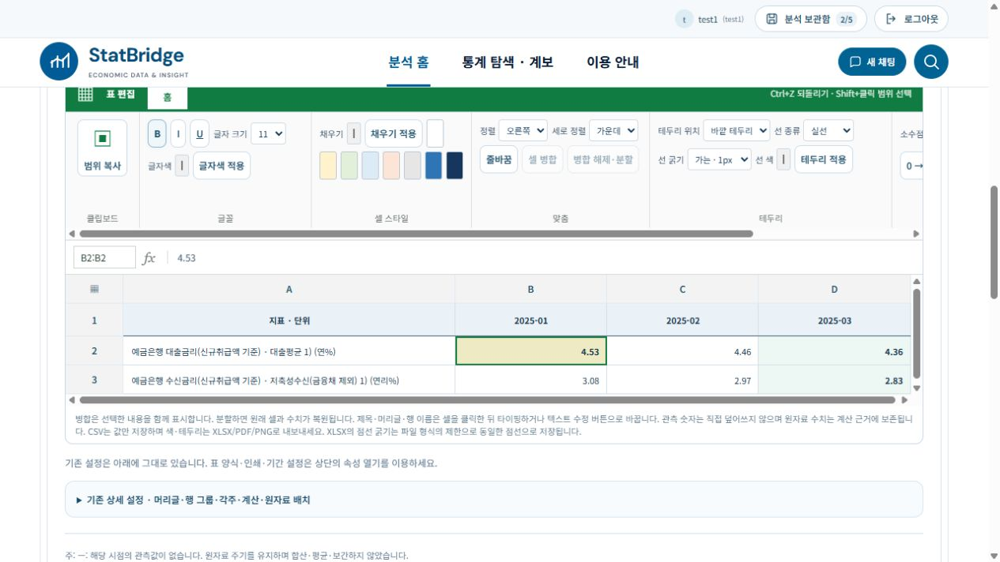

# 2026-10-20 보고서 설명·출력 크기·엑셀형 셀 편집 UI

ai-assisted 변경 기록. local1과 StatBridge1에 코드 20개 파일을 동일하게 반영했다. 각 환경의 .env, 계정 DB, 저장 분석과 서비스 포트는 동기화 대상에서 제외했다.

## 엑셀형 편집 UI

셀 직접 편집 영역을 초록색 홈 리본과 회색 그룹 영역으로 재배치했다. 클립보드, 글꼴, 셀 스타일, 맞춤, 테두리, 표시 형식, 보기 그룹을 제공한다. 굵게·기울임·밑줄, 글자 크기·색, 채우기, 병합·분할, 가로·세로 정렬, 줄바꿈, 테두리 위치·종류·굵기·색과 숫자 표시 기능은 기존 검증된 편집 명령을 그대로 사용한다. 선택 주소와 fx 표시줄을 분리하고 선택 셀을 초록 테두리로 표시한다. 작은 화면은 리본을 가로로 스크롤한다.

Ctrl+Z, 범위 선택, 우클릭, 행·열 크기 조절과 가장자리 자동 스크롤 코드는 유지한다. 원자료 관측 숫자 직접 수정과 임의 엑셀 수식 실행 기능을 추가한 것은 아니다. 제목·머리글·행 이름 편집과 서식 편집 범위는 기존과 같다.

## 현재 그래프 설명

외부 토글을 보고서 작성하기로 변경했다. 현재 그래프·표를 명시하는 일반 변화율 질문은 표시 중인 계열과 표시 기간을 서버에서 읽어 계산한다. 원자료 수준을 답변에 나열하지 않고 전체 변화, 최근 변화, 변화폭의 확대·축소를 설명한다. 금리·비중은 %p, 지수·금액은 상대 변화율로 구분한다. 전월·전년 비교의 정확한 기준 시점이 없으면 누락 시점과 필요한 계산식을 안내한다. 표시 자료만으로 원인이나 전망을 꾸며내지 않는다. 이 경로는 GPT를 호출하지 않는다.

## 실제 간행물 확인과 출력 크기

다음 공개 간행물의 설명 구조를 확인했다. 전체 흐름, 최근 구간, 지표 사이 차이와 비교 기준을 구분하는 방식을 적용했으며 문장을 그대로 복제하지 않았다.

- [통화신용정책보고서 2025년 9월](https://www.bok.or.kr/portal/bbs/B0000156/view.do?menuNo=200067&nttId=10093507)
- [통화신용정책보고서 2025년 3월](https://www.bok.or.kr/portal/bbs/B0000156/view.do?depth=200754&menuNo=200754&nttId=10090271&oldMenuNo=201150&programType=newsData&relate=Y)
- [2025년도 연차보고서](https://www.bok.or.kr/portal/bbs/P0000596/view.do?depth=200071&menuNo=200071&nttId=10097176&oldMenuNo=201150&programType=newsData&relate=Y)

2025년 9월 보고서 인쇄 15쪽 그림 I-16의 원본 이미지 496×419px, 표 I-11 경계 189.26×307.22pt를 확인했다. 표는 144dpi 환산 379×614px를 예시 기본값으로 사용한다. 이는 한국은행 모든 간행물의 공통 규격을 의미하지 않는다. 출력 크기 영역을 처음 열 때 기본 크기를 적용하며 직접 변경할 수 있다. 기존 축별 600~2000/400~2000 제한은 제거했다. 양의 정수 및 총 3200만 픽셀 제한은 자원 보호를 위해 유지한다. 명시한 크기가 Plotly의 제목 공간 자동 확장보다 우선하도록 PNG와 보고서 초안 이미지 전달을 수정했다.

## 실행 검증

- local1: 관련 Python 224건 통과, 프런트엔드 Node 204건 통과, TypeScript/Vite 빌드 성공.
- StatBridge1: 프런트엔드 Node 204건 통과, TypeScript/Vite 빌드 성공. 설명·크기 독립 Python 20건 통과, endpoint 1건 제외.
- StatBridge1의 전체 관련 Python 재실행은 bridge_api를 가져오는 중 통계 사전 JSON 초기화에서 장시간 정체하여 중단했다. 이 재실행을 통과로 집계하지 않는다. 최초 실행의 PYTHONPATH 누락 수집 오류는 실행 환경 오류로 별도 확인했다. 전체 저장소 회귀 전수 검사는 이번 작업에서 실행하지 않았다.
- 실제 UI: local1(5173), StatBridge1(5174) 모두 새 리본을 렌더링했다. StatBridge1에서 B2 배경색과 굵게를 적용한 뒤 완료 상태와 선택 셀 표시를 확인했다.
- 실제 local1 질문: 예금은행 여수신 금리 2025년 1~3월 그래프에서 “해당 그래프의 변화율을 설명해줘” → 대출금리 -0.17%p, 수신금리 -0.25%p, 최근 변화 각각 -0.10/-0.14%p를 설명했다. 관측 수준 나열이나 막연한 자료 부족 안내가 없었다.
- 실제 local1 크기: 기본 496×419 적용과 사용자 580×740 적용을 확인했고, 브라우저에서 내려받은 PNG의 실제 크기도 580×740이었다. PDF는 관련 자동 검증 범위이며 이번에 브라우저 PDF 다운로드를 다시 실행하지 않았다.
- .env 해시 유지 확인. 계정/저장 그래프 행 개수 local1 5/9, StatBridge1 4/5 유지 확인. 모든 계정의 합계이며 계정별 5개 제한과 다르다.
- git diff --check 성공. Vite는 기존 대형 번들 경고가 남아 있다.

