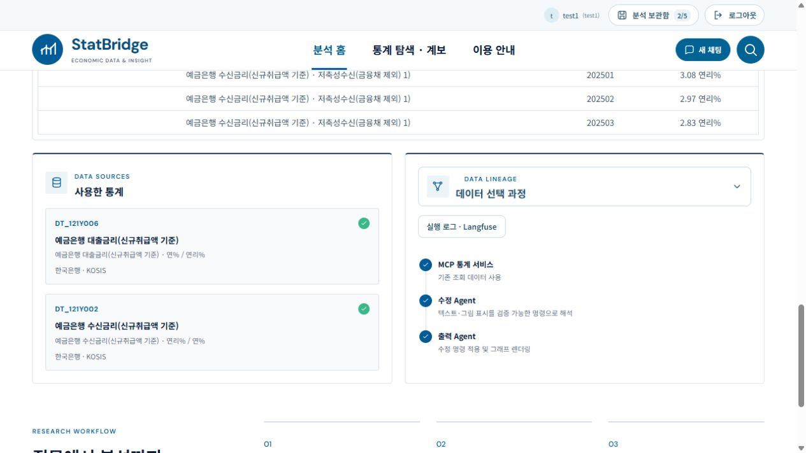

# 출력 크기·현재 자료 질문·실행 로그 UI 패치

AI-assisted 변경. local1과 StatBridge1에 같은 소스·테스트를 적용하고 백엔드를 재시작했다. 계정·저장 분석·각 `.env`는 변경 전후 해시가 일치한다.

## 사용자 화면

- 속성 맨 위에 **출력 크기 · 그래프 / 표** 토글을 추가했다. 직접 지정, 너비·높이, 비율 유지, 적용을 지원한다. 현재 안전 범위는 너비 600~2000px, 높이 400~2000px다. 선택한 크기는 편집 상태에 저장되어 취소·복원 대상이 된다.
- 그래프 PNG와 PDF/SVG, 기본 표와 셀 편집 표의 PNG/PDF 내보내기에 크기를 반영한다. PDF/SVG는 100px당 1인치 기준이며, 표는 내용 비율을 유지하고 여백으로 맞춘다. 여러 쪽 표는 쪽마다 적용한다. CSV·XLSX는 셀 데이터 형식이므로 이미지 픽셀 크기를 적용하지 않는다.
- 보고서 초안의 기본 그래프 크기도 명시적으로 지정한 속성 크기를 우선한다. 초안 안에서 따로 크기를 바꾸는 기존 기능은 유지한다.
- 현재 자료 질문 컴포넌트를 편집 버전마다 재마운트하지 않고 자체 요청 취소·버전 검증으로 갱신한다. 실제 편집 전후 질문 폼이 1개임을 확인했다.
- 질문 화면에 초기 관측 요약과 원자료 관측값 목록을 출력하지 않는다. 질문 답변은 계산된 변화·비교 결론에 집중하고 반말로 표시한다. 개별 수준값만 묻는 경우에도 답변에 수준값을 나열하지 않고 원자료 표로 안내한다. 원자료와 감사용 계산 사실은 서버에 유지하고 일반 조회·보고서 문체는 변경하지 않는다. 별도의 답변 작성 모델 호출을 추가하지 않았다.
- 데이터 선택 과정 카드에 **실행 로그 · Langfuse** 버튼을 추가했다. 기존 실행 흐름 모달을 열어 단계별 시간, 오류, 모델·토큰 기록을 확인한다. 클라우드 수신 여부는 별도로 확인하지 않았으며 SDK 활성 상태를 수신 성공으로 표시하지 않는다.

## 검증

- 관련 Python 회귀: **각 프로젝트 188 PASS, 0 FAIL, 0 SKIP**. 처음 일반 표 경로에서 크기가 적용되지 않는 것을 실제 다운로드로 발견했고, 기본·셀 편집 표의 두 경로를 테스트에 포함해 보정했다.
- 프런트엔드 Node: **각 프로젝트 203 PASS, 0 FAIL, 0 SKIP**. 두 프로덕션 빌드 통과. 기존 번들 크기 경고는 남아 있다.
- 실제 UI에서 금리 2계열 질문·출력·편집 후 질문 입력 1개를 확인했다. GPT-5.4 질문 답변은 원자료 수준값 없이 변화폭과 비교 결론을 반말로 표시했다.
- 실제 UI 다운로드 그래프 PNG **1400×750**, 기본 표 PNG **1400×750**, 표 PDF **1008×540pt**를 파일로 검사했다. 표 PNG의 내용·출처·여백을 시각적으로 확인했다. 셀 편집 표와 그래프 벡터 크기는 자동 검사로 검증했다.
- 두 앱에서 새 로그 버튼으로 시간·호출 수가 표시되는 모달을 확인했다. local1 질문 실행에서 GPT-5.4 모델명과 토큰도 표시됐다.
- 이번 패치 후 전체 2,177건을 재실행한 것은 아니다. 위 188건은 변경 영향에 맞춘 관련 회귀다.

실행 결과와 해시는 `.venv/cache/size-question-20261020/results.json`, 개별 검사 로그와 화면은 같은 폴더에 보관한다.

