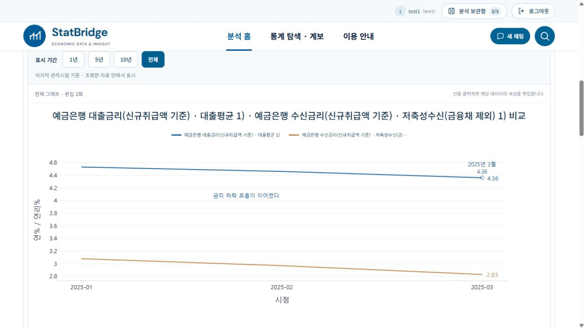
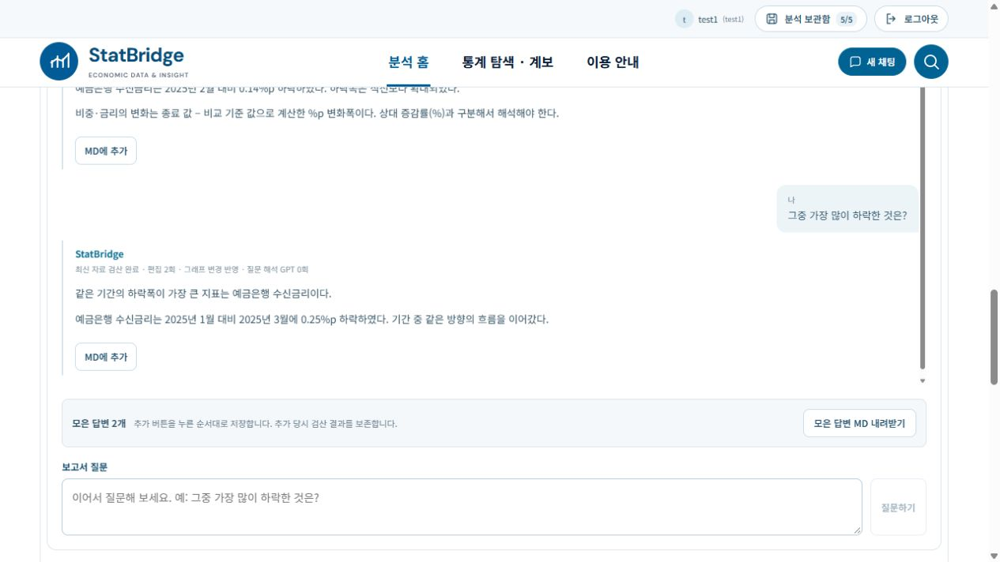
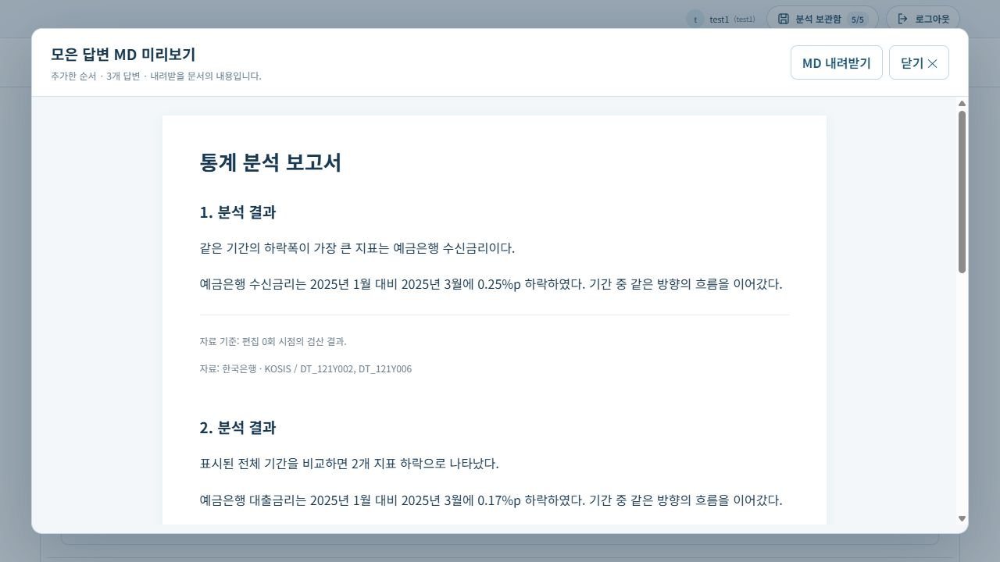
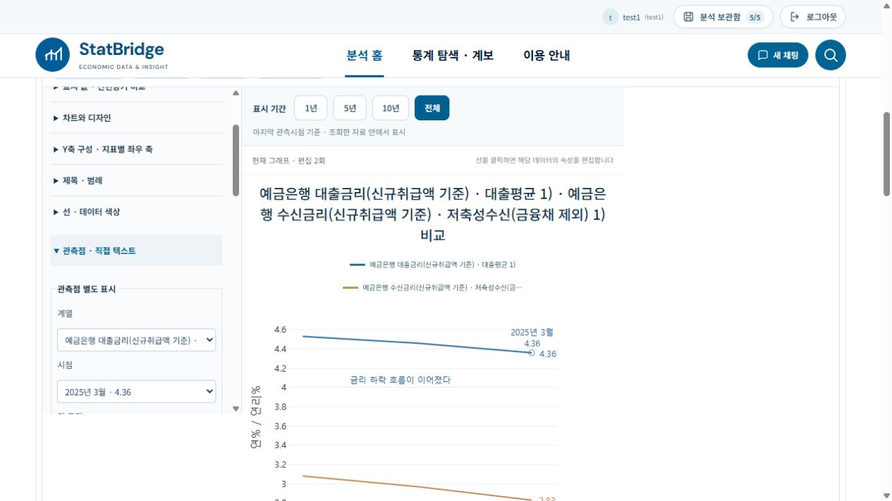
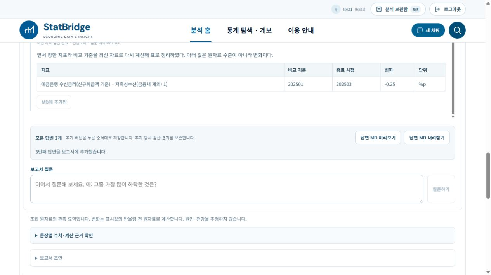

# 보고서 문체·답변 MD 수집·개별 관측점과 텍스트 주석 (2026-10-20)

## 동작

보고서 작성 대화는 이전 질문의 맥락을 유지하면서 답변 본문을 ‘이다·하다·하였다’ 문체로 출력한다. 숫자는 기존 Python 검산 결과를 유지하며 문체 변경을 위한 GPT 호출은 없다. 기존 대화는 다시 불러올 때 보고서 문체로 재구성한다.

답변 아래 ‘MD에 추가’를 누르면 누른 순서대로 서버의 해당 분석 초안에 답변을 모은다. ‘모은 답변 MD 내려받기’는 선택한 답변을 한 UTF-8 Markdown 파일로 내려받는다. 이미 내려받은 로컬 파일을 수정하는 방식이 아니라 현재 모은 답변 전체를 새 파일로 내려받는 방식이다. 같은 답변·같은 편집 버전의 중복 추가는 방지한다. 그래프 변경 후 대화 답변은 다시 검산하되, 이미 선택한 문서는 선택 당시의 검산 결과를 보존한다. 각 문단에 편집 버전과 출처를 기록한다. 최대 50개 답변·1MB이며 브라우저 로컬 캐시에는 저장하지 않는다. 분석 저장 시 기존 명시적 저장 경로로 함께 보존한다.

그래프 상단 ‘관측점 · 직접 텍스트’에서 실제 계열과 시점을 선택하거나 그래프의 실제 점 가까이를 클릭해 관측점을 선택한다. ‘관측점 표시 추가’는 해당 점만 빈 원으로 강조하고 날짜·값 라벨을 선택적으로 추가한다. 라벨은 사용자가 쓴 임의 수치를 신뢰하지 않고 현재 원자료의 실제 시점·값으로 렌더링한다.

직접 문구를 입력한 뒤 ‘그래프에서 위치 지정’으로 실제 그리기 영역을 클릭하고 ‘텍스트 추가’를 누른다. 백분율 좌표로도 위치를 지정할 수 있다. 기존 문구의 위치·내용 수정 및 삭제, 개별 관측점 표시 삭제를 제공한다. 실제 Plotly 주석이므로 이미지 내보내기에 포함된다. 기존 그림판의 편집 지시문과 별개이다. 주석 변경은 기존 편집 이력과 되돌리기 경로를 이용하며 GPT 호출이 없다.

## 검증 결과

- local1, StatBridge1 각각 Python 157건 통과, 실패 0건 (보고서·MD·관측점 29건 + 기존 관련 회귀 128건).
- 두 폴더 각각 Node 204건 통과, 실패 0건.
- 두 폴더 최종 TypeScript/Vite 빌드 통과. 기존 큰 번들 경고는 유지된다.
- 실제 두 UI에서 2025년 1~3월 예금은행 대출·수신금리 그래프를 조회했다. 보고서 본문의 하락폭은 대출 0.17%p, 수신 0.25%p이며 후속 질문에서 수신금리를 선택했다. 두 질문 모두 GPT 0회로 기록되었다.
- local1은 답변 2→1, StatBridge1은 1→2 순서로 추가했다. 실제 MD 파일을 두 앱에서 각각 내려받았으며 하나의 파일 안에 클릭 순서대로 수록되었다.
- local1은 3월 대출금리의 점과 자동 라벨을 추가하고, 그래프 안을 클릭해 사용자 문구를 가로 42%·세로 74%에 배치했다.
- StatBridge1은 2월 대출금리의 점과 자동 라벨을 추가했다. 사용자 문구를 가로 40%·세로 65%에 추가한 뒤 55%·60%로 수정하고 서버 상태와 이미지에서 확인했다.
- 두 UI에서 실제 PNG를 내려받아 개별 점·날짜·값·사용자 주석이 포함됨을 시각 확인했다.
- 주석 편집 후 보고서 대화는 최신 편집 버전으로 재검산되었고, 수집된 기존 MD 2개 항목은 추가 당시 버전 0으로 유지되었다.
- 다른 계정의 MD 접근 404, 오래된 편집 버전 409, 중복 선택, 선택 스냅샷 보존, HTML 이스케이프, 잘못된 관측점, 이동 범위를 검증했다.
- 두 백엔드를 재시작했다. .env 해시는 기존과 동일하고 계정/저장 분석 수는 local1 5/9, StatBridge1 4/5로 유지된다.
- 변경 소스 17개 파일의 두 폴더 내용 일치 확인.

## 검증 범위와 제한

이번 변경에 새 GPT 호출은 필요하지 않았다. 자유로운 질문 해석의 모든 표현을 재평가한 것은 아니다. 실제 다운로드 검증은 MD와 PNG에 수행했다. PDF·SVG의 동일 주석 렌더링 경로는 연결되어 있으나 이번 UI에서는 별도로 다운로드해 검사하지 않았다. 개별 점은 현재 실제 관측값에만 연결하며 빈 공간에 임의 통계값을 생성하지 않는다. 텍스트 위치 선택 범위는 그래프의 실제 그리기 영역이다. 참조 이미지의 통계 수치를 복사하거나 새 통계를 만들지 않았다.

## 화면 증거

## 추가: MD 확대 미리보기

‘모은 답변’ 옆에 ‘MD 미리보기’를 추가했다. 표 확대 보기처럼 별도 모달로 열리며 본문·표·출처를 클릭 순서대로 보여준다. 내부 스크롤, 닫기 버튼, Escape, 모달 안 MD 내려받기를 제공한다. 같은 서버 선택 스냅샷을 사용하므로 추가 API 조회나 GPT 호출이 없다. 실제 두 앱에서 열기·닫기, local1에서 Escape·내려받기 및 계산 표 렌더링을 확인했다. 두 앱 빌드를 통과했다. 계정·저장 분석·백엔드 변경은 없다.

## 추가: 편집 패널과 MD 버튼 위치 조정

관측점·직접 텍스트 패널을 그래프/표 탭 아래에서 제거하고 왼쪽 속성의 ‘선 · 데이터 색상’ 바로 다음으로 이동했다. 좁은 속성 패널에서는 입력 항목이 한 열로 배치된다. 그래프 화면에서 ‘속성 열기’로 접근한다. MD 버튼은 오른쪽 단일 액션 그룹으로 묶고 ‘답변 MD 미리보기’, ‘답변 MD 내려받기’로 변경했다. 두 앱의 실제 DOM에서 이전 위치 0개·왼쪽 패널 1개를 확인하고 색상 다음 순서와 미리보기 열기·닫기를 검증했다. local1에서 두 버튼의 y 좌표가 같아 나란히 배치됨을 확인했다. 두 앱의 TypeScript/Vite 빌드를 통과했다. 백엔드·계정·저장 분석은 변경하지 않았다.

