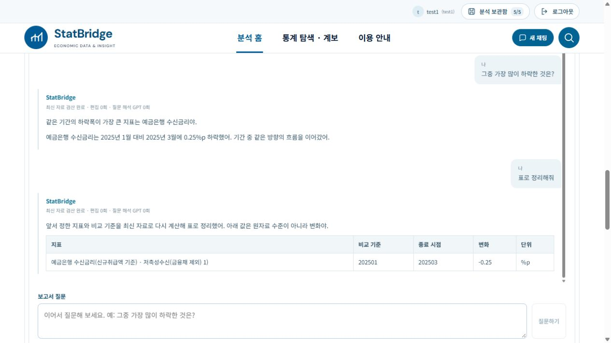
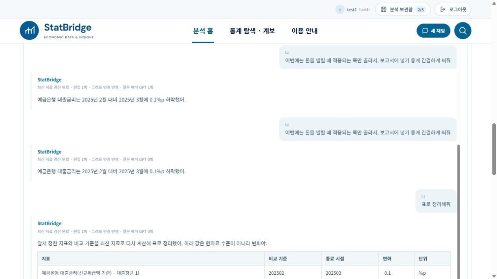

# 2026-10-20 보고서 작성 대화 맥락과 최신 자료 재검산

ai-assisted 구현 기록. local1과 StatBridge1에 동일 소스·테스트 8개 파일을 반영했다. .env, 계정 DB, 저장 분석, 원자료와 각 포트는 동기화하지 않았다.

## 사용자 동작

보고서 작성하기의 현재 자료에 질문하기를 연속 대화 UI로 변경했다. 질문을 보내도 앞선 질문과 답변이 사라지지 않는다. 같은 분석 세션에서 최근 20개 대화와 선택 지표·계산 기준·출력 형식을 유지한다. 원자료 관측 수준을 답변에 나열하지 않는 기존 정책과 반말 답변은 유지한다.

예시 흐름:

1. 해당 그래프의 변화율을 설명해줘
2. 그중 가장 많이 하락한 것은?
3. 표로 정리해줘
4. 그 계산식을 알려줘
5. 같은 기준으로 전월대비로 보여줘

정해진 예문만 받을 수 있는 구조는 아니다. 규칙으로 확실히 해석할 수 없는 자연어는 기존 GPT-5.4 연결에 현재 계열 메타데이터와 최근 질문·답변 요약·선택 맥락을 제공해 해석한다. 모델은 지표 선택·비교 기준·분석 작업·표현 형식으로 된 구조화 계획만 만든다. 실제 값과 계산 결과는 서버가 현재 조회 자료에서 계산한다. 모델이 수치나 Python 코드를 만들어 실행하는 경로는 없다.

현재 제공하는 분석은 변화 설명, 상승·하락·변화폭 순위, 두 지표의 수준 격차 및 변화폭 차이, 계산식 설명이다. 보고서 문단·간결한 설명·쉬운 표현·글머리·표 형식을 지원한다. 일반 지식 챗봇처럼 모든 주제나 임의 분석 기법을 지원한다는 의미는 아니다. 현재 표시 자료 범위를 벗어나거나 인과·전망을 판단할 근거가 없으면 이를 확정하지 않는다.

## 그래프·표 변경

편집 revision 또는 그래프/표 보기 변경 시 서버 대화 계획을 최신 표시 자료로 다시 실행한다. 질문과 해석 계획은 이어받고 과거 계산 수치는 복사하지 않는다. 순위가 바뀌면 그 순위를 참조한 후속 답변도 순서대로 다시 계산한다. 표의 선택 계열·최근 기간 설정도 적용한다. 화면에는 최신 검산 revision과 그래프 변경 반영을 표시하고 검산 전의 이전 수치는 숨긴다.

과거 질문에 명시된 시점이 최신 자료에서 사라졌다면 그 날짜와 지표를 보완하도록 안내한다. 제거한 계열의 과거 숫자나 결측 시점 값을 임의 대체하지 않는다. 새 분석 세션에서는 대화를 분리한다. 대화 이력은 서버 분석 세션에 보관하며 브라우저 localStorage에 별도 캐시하지 않는다. 분석 보관함에 저장하면 기존 저장 경로가 대화 이력도 포함한다. 저장하지 않은 세션은 서버 재시작 뒤 복원을 보장하지 않는다.

## 호출 최소화

- 명확한 후속 순위·계산식·기간 비교·형식 변경은 결정론적 경로로 처리한다.
- 비정형 표현은 GPT 해석 1회로 계획을 받고 별도 문장 생성 호출 없이 서버 계산으로 답한다.
- 검증 계획은 세션별 최대 32개 캐시한다. 원자료 결과 캐시를 답변으로 재사용하지 않는다.
- 같은 자연어 요청 반복과 그래프 변경 재검산은 검증 계획을 다시 실행한다.
- 모델 입력은 전체 원자료 대신 메타데이터와 최근 4개 대화 요약으로 제한한다.
- report.conversation.plan / report.conversation.calculate / report.conversation.refresh 단계는 기존 실행 로그·Langfuse 계측을 사용한다.

## 안전성과 API 호환

키와 명령이 닫힌 Pydantic 스키마를 사용하고, 알 수 없는 계열 ID·중복 선택·임의 필드·허용되지 않은 연산을 차단한다. Python Decimal 기반 실제 계산 결과만 사용한다. 순위·격차 비교 시 단위·주기·비교 시작/종료 시점을 검증한다. 분모 0·음수와 결측 시점은 중단한다.

대화 GET은 소유 계정을 검증하며 POST는 기존 세션 소유권 검증을 유지한다. 그래프 변경이나 다른 질문과 경합하면 revision 및 conversation_version 검사로 이전 답변의 덮어쓰기를 차단한다. 모델 장애는 HTTP 503으로 구분하고 자료 부재로 오인하지 않는다. 입력 질문과 이전 대화는 오류 시 유지한다.

기존 독립 질문 API는 호환을 유지했다. 새 UI는 POST /api/report/question에 conversational:true, display_mode, conversation_version을 보낸다. GET /api/report/conversation/{edit_session_id}?display_mode=graph|table로 최신 재검산 대화를 읽는다.

## 자동 검증

| 검증 | local1 | StatBridge1 |
|---|---:|---:|
| 관련 Python 회귀 | 252 통과 / 실패 0 | 252 통과 / 실패 0 |
| 프런트엔드 Node 회귀 | 204 통과 / 실패 0 | 204 통과 / 실패 0 |
| TypeScript/Vite 빌드 | 성공 | 성공 |

Python 범위: report_conversation, report_conversation_api, account_auth, visible_chart_commentary, focused_question_and_size, statistical_question, report_tables, report_review_regressions, publication_yoy, table_sheet, table_orientation_edit, table_reference_edit, table_layout, report_draft_pdf. 최종 프롬프트의 이전 답변 요약 보완 후 conversation 단위 검증 16건도 각 폴더에서 다시 통과했다. 반복 실행은 전체 건수에 합산하지 않았다. 기존 전 저장소 전수 회귀와 300건 GPT 평가는 이번 작업 범위에서 실행하지 않았다. Vite의 기존 대형 번들 경고는 남아 있다.

신규 검증은 지시어 후속 질문, 순위·계산식·표 전환, 최신 데이터에서 순위 및 종속 답변 변경, 삭제된 계열, 정확한 누락 시점, 단위·주기 불일치, 0 분모, 모델 호출 캐시, 알 수 없는 계획·키, 모델 장애 중 이력 보존, 다른 계정 접근 거부, 그래프/질문 경합, 저장 분석 복원 후 대화 재개를 포함한다. 계정 및 저장 복원 테스트는 임시 DB와 임시 파일로 실행했다.

## 실제 UI 및 공급자 검증

두 앱의 예금은행 여수신 금리(신규취급액, 2025년 1~3월)를 실제 조회해 사용했다. 첨부 그림 숫자를 정답으로 사용하지 않았다.

- 첫 질문: 대출금리 -0.17%p, 수신금리 -0.25%p를 설명했다.
- “그중 가장 많이 하락한 것은?”: 앞선 두 지표 중 수신금리를 선택했다. 두 앱 모두 GPT 호출 0회였다.
- local1의 “표로 정리해줘”: 앞서 선택한 수신금리와 동일 비교 기준으로 표를 출력했다. GPT 0회.
- “돈을 빌릴 때 적용되는 쪽만 골라서 … 간결하게 써줘”: 실제 GPT-5.4가 대출금리를 선택했다. 최종 StatBridge1 실행에서 1회, 입력 1,317토큰·출력 339토큰·합계 1,656토큰이었다. 이전 답변 맥락은 입력에 포함하지만 수치는 서버가 검산한다.
- 같은 자유 표현을 반복했을 때는 계획 재사용으로 GPT 호출 0회였고 결과는 같은 자료에서 다시 계산했다.
- 각 앱에서 기간을 2025년 2~3월로 변경했다. 기존 질문·답변을 유지하면서 대출금리 -0.10%p, 수신금리 -0.14%p로 다시 계산했다. 순위와 후속 표의 대상도 일관되게 유지했다. 재검산 GPT 호출은 0회였다.
- 그래프 변경 후 계산식 질문도 앞선 대상·기준을 이어받았다.

실행 로그로 확인한 대표 서버 시간은 자유 표현 해석 6,692.918ms(GPT 1회), 동일 질문 반복 10.906ms(GPT 0회)였다. 전자는 OpenAI 생성 단계 6,679.709ms였다. 재검산은 7~수십 ms 범위였다. 단일 사례의 서버 측 관측이며 UI 전체 지연 또는 일반적인 p50/p95 성능으로 주장하지 않는다. 이번 단계에서는 Langfuse 외부 대시보드를 별도로 다시 열지 않았으며 서버 계측으로 호출·토큰·시간을 확인했다.

실제 새 백엔드를 재시작하고 검증했으며 계정/저장 그래프 합계 local1 5/9, StatBridge1 4/5와 .env 해시 유지를 확인했다. 기존 사용자 분석을 추가·삭제·덮어쓰지 않았다. 소스·테스트 8개 파일의 바이트 일치 및 git diff --check를 확인했다.

