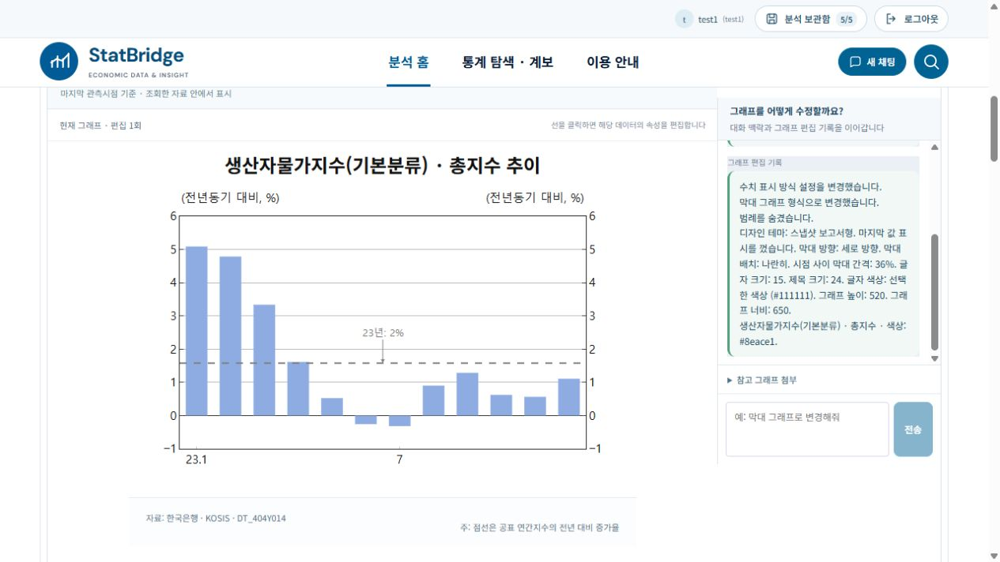
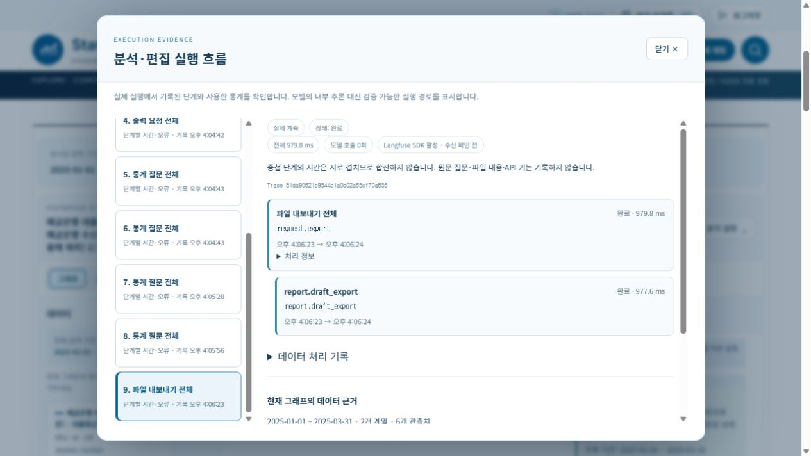

# 팀원 변경 선별 이식 및 검증

## 범위와 병합 기준

2026-10-20에 제공된 `statbridge4.zip`, `2026-10-20-changes.md`, `2026-10-19-ui-changes-image-ratio.md`를 현재 코드와 비교했다. 대상은 `StatBridge-local1`과 `StatBridge1/StatBridge-official`이다. ZIP의 소스 전체를 덮어쓰지 않고 변경 내용을 추출했다. ZIP의 문서에 적힌 과거 테스트 결과는 이번 실행 결과와 구분한다.

사용자 선택에 따라 **실행 흐름·전체 실행 근거 진입점을 유지**했다. 기존 Langfuse 계측, 검증된 파생지표 계획 재사용, 메타데이터 사전 제공, 표 셀 편집·파일 첨부, 수동 저장·최대 5개 정책을 유지했다. 각 프로젝트의 `.env`, 포트, 계정, 저장 분석, 원자료와 런타임 파일은 동기화하지 않았다.

## 반영 내용

- 여수신 금리 표현을 대출·수신의 두 실제 통계표 조회로 연결한다. 기관·신규취급액/잔액·기간 조건을 유지하고 한쪽 자료가 빠지면 조용히 대체하지 않는다.
- 현재 자료 질문: 모델은 계열 ID와 비교 방법을 선택하고 숫자는 서버가 원자료와 Decimal로 계산한다. 복수 질문은 최대 4개로 나누며, 답할 수 있는 부분과 필요한 추가 자료를 나누어 표시한다. `연%`·`연리%` 비교에서 원자료 단위와 출처를 보존한다.
- 답변 후 처음 그래프 설명을 접어서 표시하고 다시 펼칠 수 있다. 문장에 표시하는 계열 이름은 간소화하되 실제 ID·관측값은 변경하지 않는다.
- 속성 그룹을 접고 펼칠 수 있으며 제목·계열·축 선택과 연동한다. 입력 필드와 모달의 기본 동작을 보존하면서 그래프 Ctrl+Z/Ctrl+Y와 중복 실행 방지를 연결했다.
- 지수 수준/전년동기 변환과 필요한 과거 관측값 조회를 연결했다. 이미 비율인 계열은 다시 증감률로 바꾸지 않으며 연간 공식 관측값과 월평균을 혼동하지 않는다.
- 전년동기 막대의 간행물 배치와 기본 이미지 비율 715:662를 반영했다. 일반 디자인을 선택하면 간행물 전용 배치를 해제한다.
- 참고 그림의 상세 계열 요청을 같은 통계 계열의 실제 메타데이터·자료로 확장하는 경로를 반영했다. 그림의 숫자를 원자료로 복사하지 않는다. 병렬 자료 조회에도 실행 로그 문맥을 전달한다.
- 보고서 초안은 현재 표시 자료에서 검증한 사실을 바탕으로 만든다. 세션 소유권·편집 버전·초안 ID를 검증하고 그래프가 변경되면 낡은 초안의 사용을 막는다.
- 보고서 이미지 크기, 비율 유지, 원래 크기 복원, HTML/PDF 저장·인쇄 UI를 반영했다. PDF 저장은 기존 초안과 PNG로 처리하며 추가 모델·통계 API 호출이 필요 없다.
- 하단의 중복 질문 예시 영역을 제거하고 기존 경상수지 기간 재입력 보정을 반영했다.

계정·보관함 구현, 풍부한 표 편집기, 기존 관측 원자료 배치와 편집 취소 이력은 팀원 ZIP의 오래된 코드로 되돌리지 않았다. 사용하지 않는 `data_snapshot.py`, 대체 업로드 복구 컴포넌트, 과거 동기화 스크립트도 새로 추가하지 않았다.

## 실제 UI 및 API 검증

두 앱의 백엔드를 각 프로젝트 환경으로 재시작했다. 로그인된 테스트 계정에서 다음 질문을 직접 입력했다.

> 예금은행 여수신 금리를 신규취급액 기준으로 2025년 1월부터 3월까지 월별 선 그래프로 보여줘.

두 앱 모두 실제 KOSIS 자료 `DT_121Y006`, `DT_121Y002`를 표시했다. 1~3월 대출금리 4.53, 4.46, 4.36 / 수신금리 3.08, 2.97, 2.83을 확인했다. 조회·출력의 모델 호출은 각각 0회였다.

> 대출금리와 수신금리 중 어느 쪽이 더 빠르게 변했나요? 대출액 구성은 어떻게 변했나요?

두 앱 모두 금리 변화는 실제 수치로 답하고, 대출액 구성은 금액·구성항목 자료가 필요하다고 구분했다. 이 복수 질문은 모델 2회, 보고서 초안은 1회 호출했다. 처음 설명 열기와 계산 근거 진입점도 확인했다.

| 실제 계측 | local1 | StatBridge1 |
|---|---:|---:|
| 금리 조회 | 3,541 ms / 모델 0회 | 3,822 ms / 모델 0회 |
| 그래프 출력 | 687 ms / 모델 0회 | 776 ms / 모델 0회 |
| 복수 질문 | 4,963 ms / 모델 2회 | 4,197 ms / 모델 2회 |
| 보고서 초안 | 3,155 ms / 모델 1회 | 2,820 ms / 모델 1회 |
| PDF 저장 | 980 ms / 모델 0회 | 1,444 ms / 모델 0회 |

위 수치는 각 1회 대표 실행이며 성능 분포나 개선율을 의미하지 않는다. 원본 실행 근거는 각 프로젝트 `.venv/cache/teammate-import-20261020/ui-traces.json`에 보관했다. 실행 흐름 모달에 단계·시간·호출 수·자료 출처가 보인다. 이번 이식 검증에서 Langfuse 클라우드 수신을 별도로 재조회하지 않았으며, SDK 활성 표시를 클라우드 수신 성공으로 간주하지 않았다.

두 앱에서 보고서 초안을 생성하고 PDF를 실제 다운로드했다. local1에서는 HTML 저장과 이미지 너비 548→800, 높이 653→953의 비율 유지도 확인했다. PDF 두 파일 모두 1쪽으로 열리고 한글 설명·출처·그림이 포함됐다. local1 PDF를 PNG로 렌더링해 확인했다.

기존 표 셀 편집 도구가 두 앱에 남아 있는지 확인했다. StatBridge1에서 행·열 배치를 실제로 전치하고 원래 배치로 복원했다. local1에서 제목 편집·Ctrl+Z·Ctrl+Y로 변경과 복원을 확인했다. 테스트 중 분석 저장·삭제는 실행하지 않았다.

local1에서는 `2023년 1월부터 12월까지 생산자물가지수(기본분류) 총지수를 월별 선 그래프로 보여줘.`를 추가 입력했다. 실제 `DT_404Y014` 조회 후 **전년동기 막대그래프**를 눌러 과거 자료 확보·증감률 계산·간행물 배치·공식 연간 지수 기준선을 확인했다. 참고 파일 입력은 PNG·JPG·WebP·PDF 안내를 유지한다. 실제 이미지 파일의 외부 모델 전송은 추가로 실행하지 않았다.

## 회귀 검사 및 보존

자동 검사는 모델 키를 비활성화하고 격리된 테스트 DB로 실행했다. 모의 테스트를 실제 GPT/KOSIS 검증 결과로 계산하지 않는다.

- 프런트엔드 Node 검사: 각 프로젝트 203건 통과, 실패·미실행 0건.
- 추가 기능 관련 Python 검사: 각 프로젝트 129건 통과, 실패·미실행 0건.
- 프런트엔드 프로덕션 빌드: 두 프로젝트 통과. 번들 크기 경고는 남아 있다.
- 전체 공개 Python 회귀 최초 실행: 2,176건 통과, 1건 실패, 355개 하위 검사 통과. 실패는 질문 엔드포인트가 추가한 정상 실행 로그를 세션 불변 검사에서 허용하지 않은 테스트 충돌이었다. 계산·원자료·편집 상태 전체 비교는 유지하면서 `observability`만 별도 취급하도록 보정했다. 최종 전체 실행 수치는 별도 검증 JSON과 아래 기록을 참조한다.
- 동기화한 소스·테스트·팀원 과거 문서 56개는 두 프로젝트에서 바이트 단위로 일치했다.
- 변경 전후 `users`, `graphs` 테이블과 `.env` 해시가 각각 일치했다. local1은 계정 5개·저장 분석 9개, StatBridge1은 계정 4개·저장 분석 5개를 보존했다. 저장 분석 수는 전체 계정 합계다.

**최종 전체 공개 회귀:** local1의 107개 테스트 파일에서 2,177건 통과, 실패 0건, 미실행 0건, 하위 검사 355건 통과. 실행 중 소스·테스트 해시 변화 없음, 소요 619.97초. StatBridge1에서는 동일 반영 파일의 일치를 확인하고 추가 기능 Python 129건과 프런트엔드 203건을 별도 실행했다. StatBridge1에서 전체 2,177건을 별도로 중복 실행한 것은 아니다. 개별 검사 129건은 전체 회귀와 겹치므로 합산하지 않는다.

[검증 결과 JSON](2026-10-20-teammate-integration-validation.json)에 최초 실패와 최종 결과, 두 프로젝트별 검사 범위, 보존 확인을 구분했다. 선택 파일 `git diff --check`와 Python 32개 파일 구문 검사를 통과했고, 이식 목록에 `.env`·원자료·런타임 경로가 없는지 확인했다.

검증 로그·이식 목록·변경 전 백업·해시는 각 프로젝트 `.venv/cache/teammate-import-20261020/`에 둔다. ZIP 원본과 사용자 첨부 원본은 수정하지 않았다.

## 검증 범위의 한계

모든 자연어 표현·참고 이미지 조합·브라우저 인쇄 대화상자를 전수 실행한 결과는 아니다. 참고 이미지 상세 계열 확장, 예외·권한·자료 부족·과거 기간·PDF 경계 조건은 자동 회귀로 검증했고, 실제 모델을 이용한 이미지 해석 전수 평가는 이번 범위에 포함하지 않았다. 기존 300개 파생지표 평가 전체를 다시 실행했다고 주장하지 않는다.
